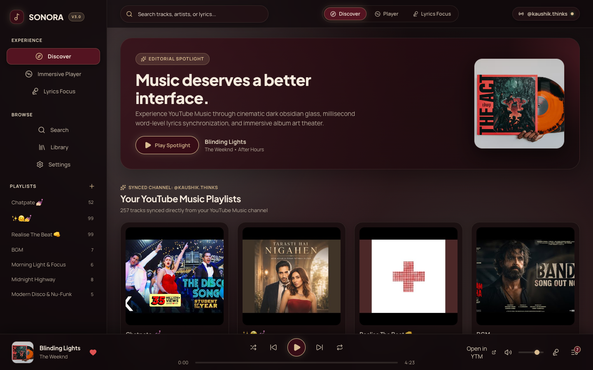
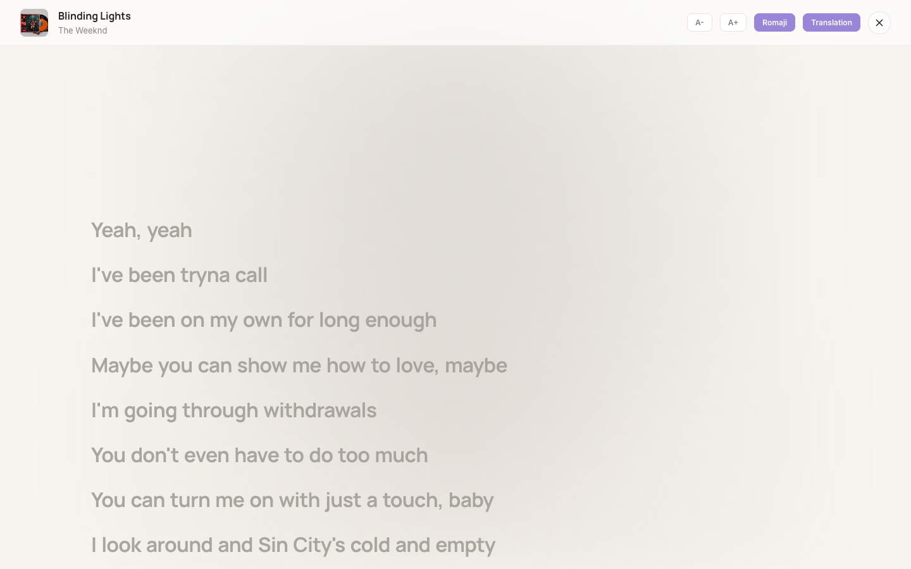
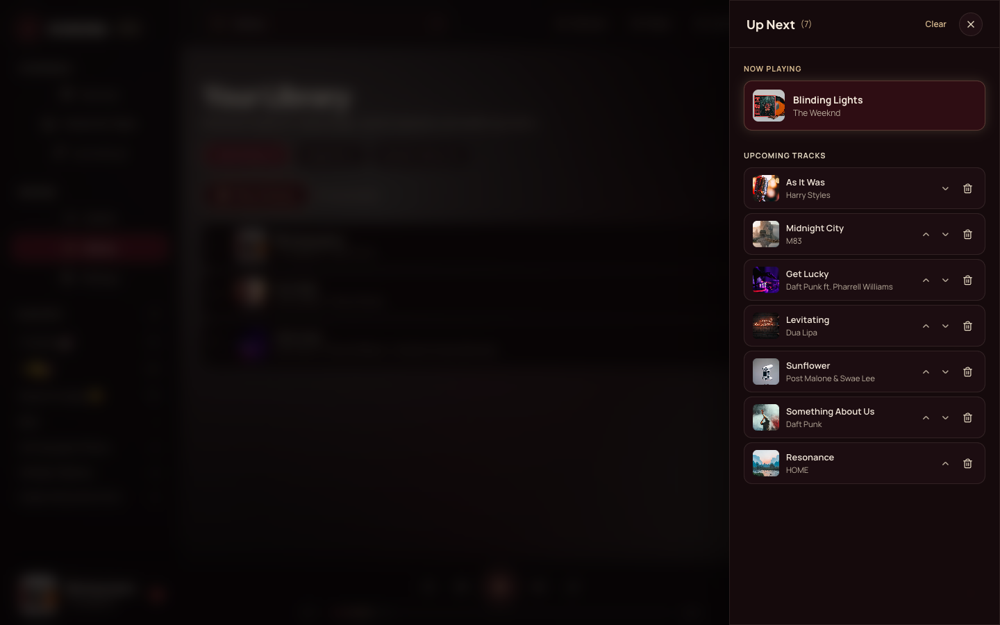
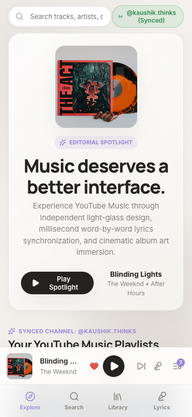

# SONORA

> **Music deserves a better interface.**

SONORA is a standalone, browser-based music application designed around the YouTube Music catalogue. It delivers an editorial light-glass visual identity, millisecond word-by-word synchronized lyrics, dynamic artwork-derived visual environments, and a modular playback-provider architecture.



---

## Key Features

- **Editorial Light-Glass Identity:** Bespoke `#F6F4EF` stone surface, liquid-glass cards, Inter and Manrope typography, and zero generic AI slop.
- **Word-Level Synchronized Lyrics Studio:** Apple Music-grade karaoke presentation with real-time word highlighting, active line auto-centering, user-scroll detection with 5-second auto-resume, romanization, translations, and instrumental rhythm breaks.
- **Official Playback Engine:** Powered by Google's official YouTube IFrame Player API for 100% compliant, cross-browser streaming without CORS issues or DRM violations.
- **Seamless External Handoff:** Dedicated direct-link adapter to `music.youtube.com` for restricted tracks or native YouTube Music accounts.
- **Dynamic Ambient Atmosphere:** High-efficiency offscreen canvas color quantizer and Kawarp-inspired ambient lighting mesh that responds dynamically to album artwork.
- **Non-Destructive Queue:** Priority "Play Next" injection, drag-and-drop reordering, and Fisher-Yates shuffle with reversible permutation mapping.
- **Local-First Library:** Persistent Liked Songs, custom playlist creation, and listening history stored locally in IndexedDB/LocalStorage.

---

## Screenshots

| Desktop Discover | Lyrics Studio (Word-by-Word) |
|---|---|
|  |  |

| Up Next Queue Drawer | Mobile Responsive (iPhone 13) |
|---|---|
|  |  |

---

## Architecture

```
SONORA/
├── research/                  # Audits, feasibility spikes, and repository inventories
│   ├── repositories/          # Isolated upstream research repositories (gitignored)
│   ├── screenshots/           # Headless browser validation captures
│   ├── repository-inventory.md
│   ├── lyrics-engine-audit.md
│   ├── playback-engine-audit.md
│   └── reuse-strategy.md
│
├── design/                    # Design tokens & typography system specifications
│   └── DESIGN_SYSTEM.md
│
├── docs/                      # Autonomous engineering logs & execution history
│   └── EXECUTION_LOG.md
│
├── src/                       # Production application source code
│   ├── app/                   # Root App layout and global keyboard shortcuts
│   ├── components/            # Reusable UI, Sidebar, TopAppBar, Player, AmbientBackdrop
│   ├── features/
│   │   ├── discover/          # Editorial spotlight, shelves, bento grids
│   │   ├── search/            # Instant debounced search & filter chips
│   │   ├── lyrics-studio/     # Centered word-level lyrics stage
│   │   ├── library/           # Liked songs, custom playlists, play history
│   │   └── queue/             # Priority up-next queue drawer
│   ├── providers/             # YouTube IFrame Embed player & external handoff
│   ├── services/              # LRCLIB API client, LRC/TTML parsers, synchronizer
│   ├── stores/                # Zustand player, queue, and library stores
│   ├── styles/                # Pure custom CSS tokens, player bar, lyrics animations
│   └── types/                 # Domain models, contracts, and interfaces
│
├── tests/                     # Unit test suites (Vitest)
│   ├── unit/lyricsParser.test.ts
│   ├── unit/synchronizer.test.ts
│   ├── unit/queueStore.test.ts
│   └── unit/libraryStore.test.ts
│
└── scripts/
    ├── acquire_repositories.py  # Repository acquisition engine
    └── validate_browser.js      # Playwright browser validation & screenshot capture
```

---

## Quick Start

### 1. Install Dependencies
```bash
npm install
```

### 2. Start Development Server
```bash
npm run dev
```
Open [http://localhost:5173](http://localhost:5173) in your browser.

### 3. Production Build
```bash
npm run build
```

### 4. Run Unit Tests (Vitest)
```bash
npm test
```

### 5. Start Full-Stack Backend & Frontend Server
```bash
npm start
```
Runs the production HTTP server on port 3001 serving both the InnerTube API bridge and the compiled frontend single-page application.

### 6. Cloud & Container Deployment
- **Docker:** `docker build -t sonora . && docker run -p 3001:3001 sonora`
- **GitHub Pages:** Automatically deployed via `.github/workflows/deploy.yml` on push to `main`.
- **Vercel / Netlify:** Pre-configured with `vercel.json` and `netlify.toml` for 1-click Git import.

---

## Antigravity AI Agent Integration

This repository is configured for autonomous pair programming with **Google Antigravity**:
- Project governance manifest: [`.antigravity/project-manifest.json`](.antigravity/project-manifest.json)
- Engineering standards & invariant rules: [`AGENTS.md`](AGENTS.md)
- Complete execution history & verification ledger: [`docs/EXECUTION_LOG.md`](docs/EXECUTION_LOG.md)

---

## License

Distributed under the [MIT License](LICENSE).
See [ATTRIBUTIONS.md](src/legal/ATTRIBUTIONS.md) for open-source acknowledgments.
